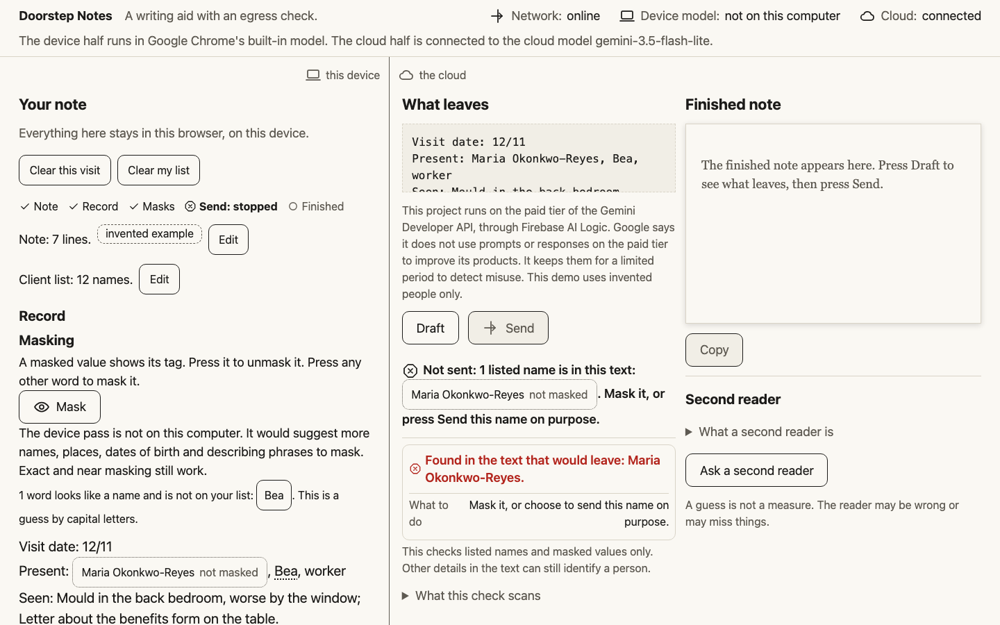
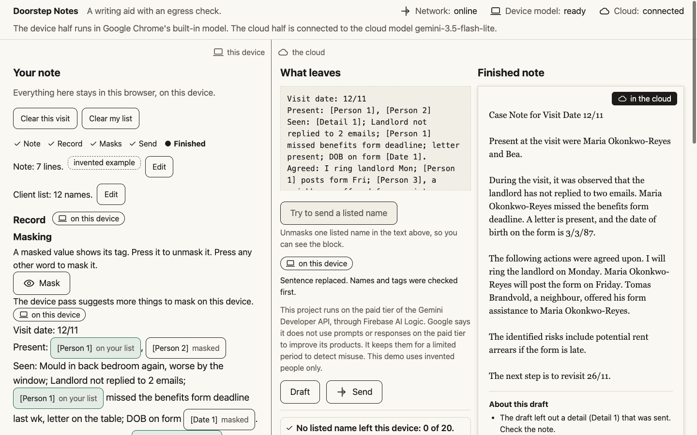
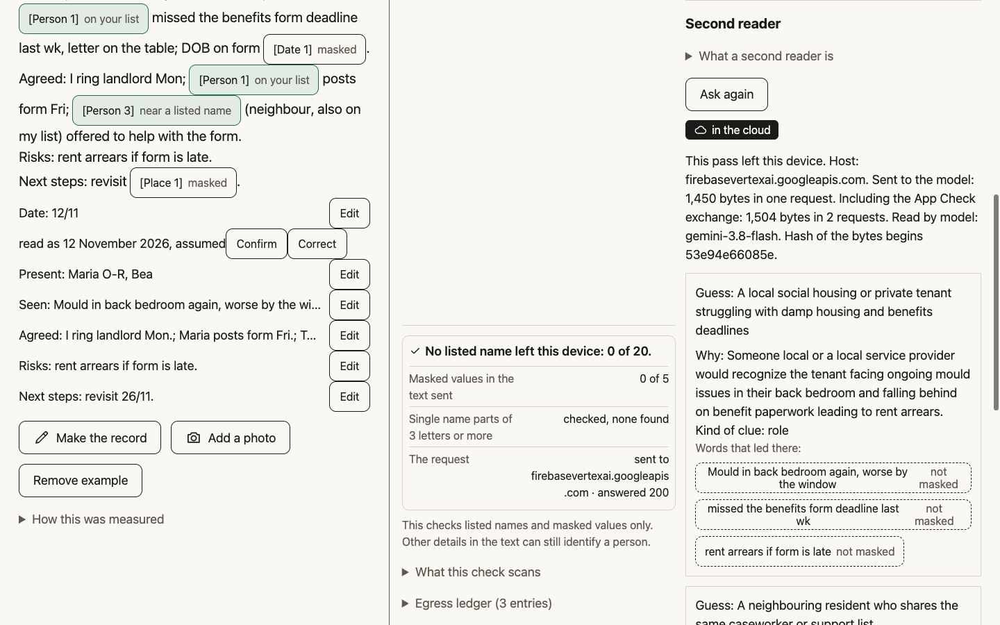

# Doorstep Notes

Dana, a housing caseworker, turns her rough visit notes into a formal case note, with her client list masked on her own computer before any text goes to a cloud model.
A writing aid with an egress check on listed names. Unlisted details can still identify a person. The device half runs in Google Chrome's built-in model. The cloud half is connected: drafts and rewrites use gemini-3.5-flash-lite, and the second reader uses gemini-3.8-flash.
Four modes of Firebase AI Logic hybrid inference, one job each: `ONLY_ON_DEVICE` structures the note and proposes masks in Gemini Nano, Chrome's built-in model; `PREFER_IN_CLOUD` drafts the note; `PREFER_ON_DEVICE` rewrites one sentence; `ONLY_IN_CLOUD` runs the second reader.
How to try it: see "Judge path" below.
The proof is in `results/hybrid-run-2026-11-14-h20.json`, `results/second-reader-loop-2026-11-14.json` and `results/catch-rate.json`.

## Judge path

Desktop Google Chrome. Hosted page: https://doorstep-notes.web.app
Press "Try an invented visit", then "Make the record".
Press "Mask". Press each button whose label starts with "Keep", for a word that should stay unmasked.
Press "Ask a second reader", then "Send".
Press "Draft", then "Send". Stop when the finished note is labelled "in the cloud".

Film:

## The five jobs

Every job goes through Firebase AI Logic hybrid inference (the `firebase/ai` module of the Firebase JS SDK), which picks the device model or the cloud model by the mode below. App Check is on for the calls to the cloud model.

| Job | Mode | Leaves the device |
|---|---|---|
| Structure the note or photo into the record | `ONLY_ON_DEVICE` | nothing |
| Propose more things to mask | `ONLY_ON_DEVICE` | nothing |
| Draft the formal note | `PREFER_IN_CLOUD` online; `ONLY_ON_DEVICE` when the app finds it is offline | the outgoing text built from the masked record, online only |
| Rewrite one masked sentence | `PREFER_ON_DEVICE` | that one masked sentence, only if the cloud answers |
| Second reader | `ONLY_IN_CLOUD` | the masked outgoing text |

### Where the code calls Firebase AI Logic

Each `getGenerativeModel` call in `src/`, by file and line, written by `npm run measure:readme` from a scan:

<!-- calls:start (written by npm run measure:readme) -->
- `src/firebase/cloudService.ts:193`
- `src/firebase/deviceInit.ts:13`
- `src/firebase/draftSdk.ts:19`
- `src/firebase/proposeSdk.ts:12`
- `src/firebase/rewriteSdk.ts:18`
- `src/firebase/structureSdk.ts:12`
<!-- calls:end -->

## Production checklist

Read 2026-11-21 from the Firebase AI Logic production checklist and the models page. Stable names have no preview, experimental or latest suffix. Both names below are listed there as release stage Stable.

| Item | Where | Value |
|---|---|---|
| draft_model | `src/constants.ts` `DEFAULT_CLOUD_MODEL` | `gemini-3.5-flash-lite`, stable |
| reader_model | `src/constants.ts` `READER_CLOUD_MODEL` | `gemini-3.8-flash`, stable. The models page uses this name as an example of a stable version |
| cloud_enabled | `src/constants.ts` `AI_SERVICE_ENABLED` | on, unless the fetched value is false. False means the cloud steps say off and no cloud request is made |
| session_cloud_cap | `src/constants.ts` `SESSION_CLOUD_CAP` | compiled cap. The page stops before another model call once the cap is spent |
| appcheck_limited_use | `src/firebase/cloudService.ts` | off unless the fetched value is true. The page uses cached standard tokens |
| mask_policy | `src/firebase/remoteConfig.ts` | name `compiled`, version 1, until a fetch replaces it. `/about` shows the name, the version and the fetch time |
| Auth | not used | no account |
| Firestore | not used | no server copy of a client |
| Fetch fallback | `src/constants.ts` `REMOTE_CONFIG_FETCH_TIMEOUT_MS` | a slower fetch, or an abort, uses the compiled defaults |
| Template | `remoteconfig.template.json` | deploys with hosting. This tree has not been deployed |

## Why it matters

The Office of the Victorian Information Commissioner found, in a report published September 2024: "OVIC’s investigation confirmed DFFH’s initial findings – that CPW1 used ChatGPT in drafting the PA Report and input personal information in doing so." (read 2026-11-14, https://ovic.vic.gov.au/wp-content/uploads/2024/11/DFFH-ChatGPT-investigation-report-20240924-Re-upload.pdf)
The provider's terms for the Gemini API say: "Do not submit sensitive, confidential, or personal information to the Unpaid Services." (read 2026-11-14, https://ai.google.dev/gemini-api/terms)

Both quotes are copied from `docs/sources.md`.

## Pictures

Send is blocked while the outgoing text holds a listed name. Pressing the name's chip masks it again.

The finished note. The draft came from the cloud model and the names were put back on this device.

The second reader, on request: what a cloud model can still infer from the masked text.

## Try it

<!-- try:start (written by npm run measure:readme from docs/submission/links.json) -->
- Hosted page: https://doorstep-notes.web.app
<!-- try:end -->

- Use desktop Google Chrome for the device half. Other browsers run the cloud half and the egress check only.
- On the first screen, press "Try an invented visit". It fills an invented note and an invented client list, so a result takes a few presses.

## Run it locally

Steps that work in a fresh copy of this folder:

- `npm ci` installs the pinned packages.
- `npm run build` builds into `dist/`.
- `npm run preview` serves `dist/` and prints the address to open in desktop Google Chrome.
- `npm test` runs the unit tests. On a clean checkout with no local Firebase config, that command reported 263 files, 2975 passed, 2 skipped and 0 failed (2026-11-23, `results/unit-clean-2026-11-23.json`). `npm run typecheck` checks types.
- `npm run e2e:bundled` builds the files the checks serve, then runs the real-browser checks in Playwright's bundled Chromium, headless, with no device model. It does not run the five real-service checks named below; those need a Firebase config. It stops when the run stops.
- `npm run e2e:device` runs the checks in Google Chrome with the built-in model. It needs the model already downloaded in `.browser-profile/`. It never starts a download. When Chrome or the model is absent it records a miss with the reason, and a miss is not a pass. A filmed check skips when `DOORSTEP_FILM_RAW_DIR` is absent.
- These commands rewrite tracked files. `npm run measure:set` rewrites `results/synthetic-set.json`. `npm run measure:exact` rewrites `results/catch-rate.json` and `results/misses.json`. `npm run measure:notneeded` rewrites `results/not-needed-kinds.json` and the not-needed block in `README.md`. `npm run measure:readme` rewrites the marked blocks in `README.md`. `npm run notices` rewrites `THIRD-PARTY-NOTICES.txt`. `npm run e2e:bundled` rewrites `results/real-browser-2026-11-13-c05.json` and `results/real-browser-2026-11-13-c05.md`. `npm run build`, `npm run build:hosted` and `npm run e2e:bundled` also write under `dist/` or `dist-e2e/`, which are not tracked. `npm run e2e:device` writes new dated files under `results/` and does not rewrite a tracked file.

Without a Firebase config the cloud steps are off: nothing is sent, a fixed sample answers, and the page says "off" where it does.

## Run it with your own Firebase project

1. In the Firebase console, enable AI Logic with the Gemini Developer API. The guided setup turns on the required APIs and enforces App Check for AI Logic (`docs/sdk-facts.md`, "App Check and project setup").
2. Register a web app in the project.
3. Copy the web app config into `firebase.config.local.json` in the project root. Git ignores that file. `firebase.config.example.json` shows the fields with placeholders.
4. Start the page, open the browser console, and read the App Check debug token it prints. Register it under App Check, Apps, Manage debug tokens (`docs/sdk-facts.md`, same section; `src/firebase/appCheck.ts`). Do not commit the token (same section).
5. In the console, check that App Check enforcement is on for AI Logic (same section).
6. The cloud model needs a project on the paid tier, as this one is: the unpaid tier refused this project on its first real call (`src/inference/refusal.ts`).
7. For a hosted build, register a reCAPTCHA Enterprise key for the page under App Check, allow the page's domain on it, and put its site key in `firebase.config.local.json` as `appCheckSiteKey` (`firebase.config.example.json` shows the field). `npm run build:hosted` builds into `dist/`, writes that file into `dist/` and stops with a plain message when the file or the site key is missing. `firebase.json` serves `dist/` through Firebase Hosting and holds no project id; the project comes from the deploy command. The file in `dist/` is served to every visitor of the page. A production build carries no debug token and asks App Check through the reCAPTCHA Enterprise provider with **cached standard tokens** — one robot check per token lifetime, not one per call (`src/firebase/cloudService.ts`). The trade is deliberate: limited-use tokens make every cloud call pay its own robot check, so a three-call path meets a refusal far more often. Caching gives up per-call replay protection in exchange for that. The limited-use path stays available behind a switch. With no site key it makes no cloud call and the status bar reads "Cloud: not configured". Of eight Chrome runs on https://doorstep-notes.web.app, six reached the real cloud service (5 passed: `results/hosted-run-2026-11-15-4.json`, `results/hosted-run-2026-11-15-5.json`, `results/hosted-run-2026-11-15-6.json`, `results/hosted-run-2026-11-15-7.json`, `results/hosted-run-2026-11-15-8.json`; 1 failed: `results/hosted-run-2026-11-15-3.json`) and two stopped before any cloud call with no model requests (`results/hosted-run-2026-11-15.json`, `results/hosted-run-2026-11-15-2.json`); newest `results/hosted-run-2026-11-15-8.json` passed with 2 generateContent calls, 3 reCAPTCHA Enterprise App Check exchanges, no debug token.

<!-- build-refusal:start (written by npm run measure:readme) -->
`npm run build:hosted` stops with "HOSTED BUILD REFUSED: the local config file is missing".
<!-- build-refusal:end -->

Which checks need what:

- The real-service checks `tests/e2e/bundled/cloudDraft.spec.ts`, `tests/e2e/bundled/shorterReal.spec.ts`, `tests/e2e/bundled/secondReaderReal.spec.ts` and `tests/e2e/bundled/secondReaderLoop.spec.ts` need `firebase.config.local.json` and the registered debug token in `appcheck-debug-token.local`. Each makes real calls to the cloud model.
- The device-model checks, `npm run e2e:device`, need the model already downloaded in `.browser-profile/`.
- Every other check runs with neither.

## Who it is for

Dana is a housing caseworker. She has just finished a home visit. There was no signal in the stairwell. She has rough notes, typed or on a photographed page, and owes a formal case note by tonight. Her employer forbids putting a client's name into a cloud AI tool, so she writes it all by hand after hours. This app does the structuring and masking on her own computer, asks the cloud only to write prose from masked text, puts the names back on her computer, and then checks what was actually sent.

## Status

- Hosted at https://doorstep-notes.web.app. Checked in Chrome against the page across 8 hosted checks: 6 reached the real cloud service and reCAPTCHA Enterprise App Check (5 passed: `results/hosted-run-2026-11-15-4.json`, `results/hosted-run-2026-11-15-5.json`, `results/hosted-run-2026-11-15-6.json`, `results/hosted-run-2026-11-15-7.json`, `results/hosted-run-2026-11-15-8.json`; 1 failed: `results/hosted-run-2026-11-15-3.json`) and 2 stopped before any cloud call with no model requests (`results/hosted-run-2026-11-15.json`, `results/hosted-run-2026-11-15-2.json`). Across real-service walk takes, 2 of 6 takes on 2026-11-14 passed (`results/film-run-2026-11-14-h22d.json`, `results/film-run-2026-11-14-h22f.json`; failed: `results/film-run-2026-11-14.json`, `results/film-run-2026-11-14-h22b.json`, `results/film-run-2026-11-14-h22c.json`, `results/film-run-2026-11-14-h22e.json`) and 4 of 12 takes on 2026-11-15 passed (`results/film-run-2026-11-15-h36-8.json`, `results/film-run-2026-11-15-h37-1.json`, `results/film-run-2026-11-15-h37-3.json`, `results/film-run-2026-11-15-h37-4.json`; failed: `results/film-run-2026-11-15-h36.json`, `results/film-run-2026-11-15-h36-2.json`, `results/film-run-2026-11-15-h36-3.json`, `results/film-run-2026-11-15-h36-4.json`, `results/film-run-2026-11-15-h36-5.json`, `results/film-run-2026-11-15-h36-6.json`, `results/film-run-2026-11-15-h36-7.json`, `results/film-run-2026-11-15-h37-2.json`); see the last step of "Run it with your own Firebase project".
- Cloud tier: paid. The details are under "The cloud half" and "What the provider keeps" below. The lines between the markers below are written from the files in `results/` by `npm run measure:readme`.
<!-- status:start (written by npm run measure:readme) -->
- Cloud draft: one run answered HTTP 200 (2026-11-17, Chromium 158.0.8127.18 (Playwright 1.65.0 bundled, headless)). Model gemini-3.5-flash-lite. Source label: in the cloud.
- Shorter: one run answered HTTP 200 (2026-11-17, Chromium 158.0.8127.18 (Playwright 1.65.0 bundled, headless)). The sentence went from 41 to 38 characters.
- Second reader: one run answered HTTP 200 (2026-11-17, Chromium 158.0.8127.18 (Playwright 1.65.0 bundled, headless)). Sent to the model: 1,357 bytes in one request. Including the App Check exchange: 1,411 bytes in 2 requests.
- Both halves in one Chrome session: pass (2026-11-17, Google Chrome 157.0.8103.79). The record, masks, offline draft and Shorter answered on this device; the second reader and the online draft answered in the cloud. Every request was recorded.
- Draft cut during the call: pass (2026-11-14, Google Chrome 157.0.8103.79). The call was cut by the test (a simulated drop, route.abort). The SDK's own fallback wrote the note, labelled "on this device".
<!-- status:end -->
- Measured figures: not measured unless a line below gives its date and browser. Every figure comes from a file in `results/`.

## What it does

1. Capture, offline. She types a rough note or adds a JPEG or PNG photo of a handwritten page. Nothing is sent.
2. The device model makes a visit record from the note: date, who was present, what was seen, what was agreed, risks, next steps. This runs on the device only. The model never writes a date: the date field keeps the note's own words, for example a day and month written with a slash. The app proposes a reading of those words, in the order of the browser's locale unless another date in the note can only be read day first, in which case every date in that note is read day first. It is shown as "read as ... , assumed" until she confirms or corrects it, and a date-like word in the record that the note does not contain is marked "not in your note" and left out of the text that leaves.
3. Her own client list, pasted once and kept only in this browser, is masked by exact and near match with no model. The device model then proposes more to mask. She can tap any word to mask or unmask it.
4. When there is a connection, the cloud drafts the formal note from the masked record. Offline, a shorter draft is made on the device and labelled as such.
5. Names are put back on the device, with pronouns from the client list entry.
6. Before sending she sees the exact text that will leave. A listed name in it blocks sending. After sending, the egress check scans the request body the browser actually sent.

<!-- date-flag:start (written by npm run measure:readme) -->
A date that carries a year is flagged in the text that would be sent, and a day and month, or a year, is flagged in a sentence that names a birth.
A day and month alone is not flagged.
<!-- date-flag:end -->

7. On request, a second reader in the cloud guesses who the masked text is about, so she can see what it can still infer and mask more. Under the guesses the page shows a line for that pass: the bytes that left the device, the number of requests, the host, the model and the start of the hash of the bytes, taken from the bytes the browser sent. When the cloud is off and a fixed sample answers, the line says no bytes left. Each guess gives a short description of the person, why the reader thinks so, the kind of clue (place, relation, date, role, name or other) and the exact words it quotes from the masked text. A quote with words she can mask is a chip she can press. A guess whose quotes are only tags such as "[Person 1]" is not shown, and the page says how many were hidden. The job asks the cloud model `gemini-3.8-flash` (`READER_CLOUD_MODEL`); drafting stays on `gemini-3.5-flash-lite`. One pass of the earlier instructions on the real service was recorded on 2026-11-14 in Playwright's bundled Chromium, headless (`results/second-reader-real-service.json`): the cloud answered HTTP 200 and the guesses were "[Person 1]", "Bea", "worker" and "[Person 2]", with tags as the evidence for two of them. The first loop with the new instructions is in `results/second-reader-loop-2026-11-14.json` (same browser, invented visit, two calls, both HTTP 200, label "in the cloud"). In pass 1 the reader gave three guesses, described as a household member, the professional and the property owner, quoting "Bea", "worker" and "landlord". She pressed the chip "Bea" and asked again. In pass 2 the text sent no longer held "Bea", no guess quoted it, and the egress card counted one more masked value (2 to 3). The reader's guesses in pass 2 were different ones, quoting other unmasked words such as "Mould in the back bedroom" and "landlord"; the file does not show that the first guess went because of the mask alone. The picture `docs/screens/18-second-reader-ask-again.png` is pass 2 of a later loop of the same check, on a build that shows the paid-tier notice (`results/second-reader-loop-2026-11-14-h23.json`, two calls, all answered HTTP 200): she pressed the chip "Bea" and asked again. The picture `docs/screens/17-second-reader-real-service.png` is from neither loop: it is pass 1 of the run of 2026-11-14 in Google Chrome with the built-in model (`results/hybrid-run-2026-11-14-h20.json`, see "What this does not show"). Each loop is on an invented visit, and the model's answers vary between runs. How many of the identifiers that the exact, near and device passes miss (describing phrases, places, other names) the reader helps her find is not measured.

Every result on screen is labelled "on this device" or "in the cloud", taken from the `inferenceSource` the SDK returns. A finished note whose draft came from the cloud carries "in the cloud". Only when a fixed sample answered, with the cloud off, does it carry one mark, "names put back on this device; draft text is a fixed sample: cloud off", in place of "in the cloud". The mark says both facts because the names in the note were restored on this device and the draft text came from the fixed sample.

## What the egress check shows, and what it does not

It shows, after a send, a card computed from the bytes the browser sent. At the top is one verdict line, for example "No listed name left this device: F of N", with F the count found and N the count of listed names checked. Under it is a table of three rows: the masked values found in the text sent, the single name parts that were also checked, and the request (none made when the cloud is off and a fixed sample answered; otherwise the host). A failure is printed in the failure colour, with a crossed octagon and words, not colour alone, and names the count and the names found. It then says what happened (the text has left this device) and what to do. That state is reachable only through the seeded test path, and the card says "Seeded for a test." when it is.

Before a send the same scan runs on the outgoing text. When it holds a listed name, Send is not available and one line beside it says "Not sent", how many listed names are in the text, and each name as a chip. Pressing a chip masks the name again. On the invented visit, "Try to send a listed name" unmasks one listed name so the block can be seen in one press. Nothing is sent while the block holds. In the check of 2026-11-13 recorded in `results/real-browser-2026-11-13-g03.json` (Playwright's bundled Chromium, headless, at the screen size the owner set for the check), the line and the chip appeared, Send was not available, the step line showed Send as stopped on one row, no request was made, and pressing the chip brought Send back. The picture is `docs/screens/14-send-blocked.png`, taken with the page at the top, so the whole block is in it. While the block holds, the egress line flows under the "Not sent" line instead of sticking to the foot of the window, so it cannot cover the line. In the check of 2026-11-14 (`tests/e2e/bundled/blockClear.spec.ts`, Playwright's bundled Chromium, headless) the "Not sent" line and its chip were inside the window and did not meet the egress line at the two screen sizes the owner set for the check. In the check of the session after it the egress line was also inside the window at both sizes, with the page at the top; to make room the outgoing text is shorter while the block holds and scrolls. Outside the block the egress line stays at the foot of the window.

The counts are computed from the bytes every time; no count is fixed in the text.

What the check scans is written under the line on the page, and here, in the same words:

> Scanned: the address and the body of each request, each listed name whole, its other names, and its single parts of 3 letters or more. A listed value of 5 letters or more is also found inside a longer word.

The two numbers are `MIN_NAME_PART_LENGTH` and `NEAR_MATCH_MIN_LETTERS` in `src/constants.ts`, and a test fails if this sentence and the page differ. A value shorter than that must stand as a whole word, so three letters inside "Tomorrow" are not a hit. Case is ignored with Unicode case folding.

It does not check unlisted details. A street, an employer, a describing phrase or a date can still identify a person and not be on her list. It does not check near variants of a name that were not masked. It does not say that nothing private left. The raw note, the photo and the client list stay in the browser and are never part of a request; the real-browser record of that is in `results/h2-part-a.json`, and it ran against the test double only (`results/kept-reload.json` and `results/real-browser-2026-11-13-e03.json` hold the later checks of the kept data).

## Figures

The lines below are written from the files in `results/` by `npm run measure:readme`. They are not typed by hand. A line with no file behind it reads "not measured".

<!-- figures:start (written by npm run measure:readme) -->
These figures describe a set of invented notes. They do not describe real notes, and they do not predict real use.

On 200 invented notes her list alone found 509 of 1,141 identifying details (2026-11-13, Node v22.23.2 (no browser)). With the model on this device: 1,032 of 1,141, on 200 of 200 invented notes (2026-11-13, Google Chrome 157.0.8103.79). Measured on the author's computer.

The model on this device also suggested 61 things that were not needed (on 200 of 200 invented notes, 2026-11-13, Google Chrome 157.0.8103.79).

False masks: first run 97, second run 66, third run 61, fourth run 37. Identifiers caught: first run 945, second run 927, third run 946, fourth run 927. The fourth run tried the date-word rule. It found fewer dates of birth (131 to 130), so the rule was taken out again and the figures above are those of the third run.

- Exact match caught 462 of 1141 identifiers on the invented set (2026-11-13, Node v22.23.2 (no browser)). False masks: 17.
- Near match caught 47 of 1141 identifiers on the invented set (2026-11-13, Node v22.23.2 (no browser)). False masks: 0.
- Exact and near match together caught 509 of 1141 identifiers on the invented set (2026-11-13, Node v22.23.2 (no browser)). False masks: 17.
- Device model pass caught 946 of 1141 identifiers on 200 of 200 invented notes (2026-11-13, Google Chrome 157.0.8103.79). False masks: 61.
- All passes together caught 1032 of 1141 identifiers on 200 of 200 invented notes (2026-11-13, Google Chrome 157.0.8103.79). False masks: 77.
- Cold start to the first record: 13 seconds, on the author's computer (2026-11-13, Google Chrome 157.0.8103.79). Not measured on this computer.
<!-- figures:end -->

By kind of identifier, from the same file:

<!-- kinds:start (written by npm run measure:readme) -->
- Listed names: 462 of 462 found by all passes together (200 of 200 invented notes, 2026-11-13, Google Chrome 157.0.8103.79).
- Other names: 131 of 137 found by all passes together (200 of 200 invented notes, 2026-11-13, Google Chrome 157.0.8103.79).
- Near variants: 47 of 47 found by all passes together (200 of 200 invented notes, 2026-11-13, Google Chrome 157.0.8103.79).
- Places: 221 of 235 found by all passes together (200 of 200 invented notes, 2026-11-13, Google Chrome 157.0.8103.79).
- Dates of birth: 131 of 131 found by all passes together (200 of 200 invented notes, 2026-11-13, Google Chrome 157.0.8103.79).
- Describing phrases: 40 of 129 found by all passes together (200 of 200 invented notes, 2026-11-13, Google Chrome 157.0.8103.79).

The lists of words the filter drops were adjusted on this same invented set, so these figures are in-sample and say little about other notes.
<!-- kinds:end -->

<!-- notneeded:start (written by npm run measure:notneeded) -->
Of the 61 suggestions that were not needed in the third run, the three largest kinds were date word (34), common word (16) and number (10).
<!-- notneeded:end -->

The set is built by `npm run measure:set` from a fixed seed and holds invented people only. The exact and near passes are run by `npm run measure:exact`. Every missed identifier and every false mask is listed in `results/misses.json`. The device pass runs in Google Chrome with the built-in model, through its own command, and is not part of `npm test`. These figures run the passes on each raw invented note. In the app the passes read only the record the device model made, so a fact the record leaves out is not checked: in the twelve replies of the invented visit recorded in `results/film-rehearsal-2026-11-14-h22b.json`, `results/film-run-2026-11-14-h22b.json`, `results/film-run-2026-11-14-h22c.json`, `results/film-run-2026-11-14-h22d.json` and `results/film-run-2026-11-14-h22f.json`, the record left out the date of birth in four.

## Kept in this browser

Kept in this browser's own store on this device. This page does not encrypt it. It relies on the lock of this device. The three clear controls remove it.

What is kept, as she works, and read back when the page loads (offline too): the client list, the note in progress and its photo, the record, the masks and what kind each is, the outgoing text, the finished note, the step she is on, the parts she opened, and the local ledger entries. The store is the browser's own (IndexedDB), in one document that carries a version.

- "Clear this visit" removes the note, the record, the masks, the outgoing text, the finished note and the step, and keeps the client list.
- "Clear my list" removes the client list and nothing else.
- "Clear everything this page keeps" is in the footer. It removes all of it, the ledger entries too.
- Each one asks once before it acts. Escape closes the question and changes nothing.
- Data of a version this page does not know is not read. The page starts empty and says: "Saved data from another version of this page was not read. Starting empty."
- If the browser will not open its store, or a save fails, the page works for the session and says: "This browser would not keep your work. Nothing is kept after you close this page."

Nothing that is kept goes into a request except the outgoing text she sees, and the egress check is unchanged.

How this was checked: unit tests, over a stand-in for the browser's store that lives in the test folder. They cover save, restore, each clear, a version the code does not know, a store that cannot be opened and a store that fails to write. The reload check in a real browser ran in Playwright's bundled Chromium, headless, on 2026-11-13 (`results/real-browser-2026-11-13-e03.json`) and again on 2026-11-14 (`results/kept-reload.json`): with the invented visit, one word masked, a draft made and the network cut, a reload brought back the note, the client list, the chips, the outgoing text and the step. The picture is `docs/screens/12-after-reload-offline.png`. "Clear this visit", "Clear my list" and "Clear everything this page keeps" were checked in the same browser against the store itself: each asked once, Escape changed nothing, and the store was empty after the last. It was not run in Google Chrome with the built-in model.

## The device model's first run

Observed on the author's computer only, in the Google Chrome version named in the figures above (sources: `docs/decisions/2026-11-13-browser-on-this-computer.md`, `results/device-model-probe-2026-11-13-raw-api.json`, `results/device-model-check.json`):

- No Chrome flag was set.
- The model went from `downloadable` to `available` after one click. The time it took on that computer's connection is `minutesToReady` in the raw-api file named above.
- Through the Firebase JS SDK release pinned at the time of that check (an earlier one than the one pinned now), a session was then made from one press with no download, and the device jobs made no outside request (`results/device-jobs-no-request.json`).
- With the model already downloaded, the first record from a cold start took 13 seconds on that computer (`results/cold-start.json`). That is the author's computer; on any other it is not measured.
- Handwriting, observed once: one page of invented rough notes, drawn in a handwriting typeface and not in a person's own hand, was added as a photo with nothing typed. It made a record labelled "on this device" and shown on the screen (`results/handwriting.json`, 2026-11-14, the Google Chrome named in the figures above, headless; picture `docs/screens/15-handwriting-record.png`). The record kept the date as written and the client's name, and read the sister's name "Ione" as "lone". The same words in printed type also made a record. A real person's handwriting and real photos have not been observed. The earlier photo test used printed text.
- The model's output is treated as text like any other. It can add a name that is not in the note, so such a name is marked "added by the model" and is not restored without her press.
- The model's context window is 9216 tokens. A long note or photo may not fit, and the app then says "this note is too long for the device model".

On a computer without the model, the app says so in one line. Hand entry of the record, exact matching, cloud drafting and the egress check still work. Nothing else about getting the model is claimed here, because only the steps above were observed.

## The cloud half

The cloud draft is connected on the author's project. On 2026-11-14 a fresh `generateContent` probe on the project answered 200, the switch `AI_SERVICE_ENABLED` in `src/constants.ts` was turned on, and the page made a real cloud draft of the invented visit: HTTP 200, source `in_cloud`, model `gemini-3.5-flash-lite`, in the Playwright bundled Chromium, headless. The status and the draft text the cloud returned are in `results/cloud-draft-2026-11-14.json`. The names in that note were put back on this device. The picture `docs/screens/05-finished-note.png` is not from this run: it was taken later in Google Chrome with the built-in model, in the run of `results/hybrid-run-2026-11-14-h20.json` (see "What this does not show"), where the finished note is also labelled "in the cloud". The same check ran twice more that day, each answered with the same status on the same model: `results/cloud-draft-2026-11-14-2.json` and `results/cloud-draft-2026-11-14-h20.json`. The status line above counts the first file only.

The earlier probe file `results/cloud-probe-2026-11-13.json` is kept as it was. It records one call that answered and later calls the provider refused with a "forbidden" answer about billing. On 2026-11-14 the owner linked a billing account to the project, and the same day a `generateContent` call answered 200 (`docs/decisions/2026-11-14-cloud-tier.md`). The unpaid tier had refused this project on its first real call (`src/inference/refusal.ts`), and that is why billing is on. Whether the 200 holds from day to day is not known.

What this does not show:

- H2 part B, a full run against the real service with invented people and every request recorded, ran on 2026-11-14 in Google Chrome with the built-in model (`results/h2-part-b-2026-11-14-h16.json`: pass). It is one run on invented people, and the model's answers vary between runs. It does not show that nothing private left: unlisted details can still identify a person.
- A second run of the same kind, after the second reader's masks were wired into the draft (`results/hybrid-run-2026-11-14-h20.json`: pass, 3 cloud model calls, Google Chrome with the built-in model, headless). In it she pressed the second reader's quote "Mould in back bedroom again, worse by the window" and asked again. The second pass, the text held for the draft and the draft request no longer held those words. Offline, the status bar read the cloud as "unreachable". The pictures `docs/screens/05-finished-note.png` and `docs/screens/17-second-reader-real-service.png` are from that run. One run on an invented visit.
- One draft is one run. The cut during the draft call ran once (`results/draft-network-drop-2026-11-14-h18.json`: pass): the SDK's own fallback wrote a note labelled "on this device". A network that drops at another moment has not been tried.
- The second reader and "Shorter" and "Plainer" are switched to the cloud by the same switch. "Shorter" has one record per run against the real service, each run in Playwright's bundled Chromium, headless: `results/rewrite-real-service.json`, `results/rewrite-real-service-2026-11-14-h20.json` and `results/rewrite-real-service-2026-11-14-h23.json`. The Shorter line under "Status" reads the newest file, and `docs/screens/16-shorter-real-service.png` is from that run. The model's answer to the same sentence differed between runs; each file gives its own character counts, or none when the cloud did not answer. The second reader ran once (`results/second-reader-real-service.json`) and as loops of two passes with the new instructions (`results/second-reader-loop-2026-11-14.json`, `results/second-reader-loop-2026-11-14-h23.json`). "Plainer" has not been run against the real service.
- Cloud tier: paid. See the next section.

Device jobs do not wait on the switch: they call the SDK whenever the browser reports the model `available`.

## What the provider keeps

This project runs on the paid tier of the Gemini Developer API, through Firebase AI Logic. The owner linked a billing account to the project on 2026-11-14 (`docs/decisions/2026-11-14-cloud-tier.md`). The reason is that the unpaid tier refused the project, not any rule about where the user lives.

From the provider's terms, read 2026-11-14 (https://ai.google.dev/gemini-api/terms): Google "doesn't use your prompts (including associated system instructions, cached content, and files such as images, videos, or documents) or responses to improve our products" on the paid tier. In short, in our words: Google logs prompts and responses for a limited period, only to detect and prevent violations of its Prohibited Use Policy and for any required legal disclosure. The data-use section for the paid tier names no number of days, so none is stated here. The app shows the paid-tier notice beside Send.

This demo uses invented people only. Check the provider's current terms before real client data is used. This README makes no claim that the project meets any law or standard.

On the unpaid tier, what is sent may be used by the provider to improve its products and may be read by reviewers, and the provider says not to send sensitive or personal information on that tier. That tier is not used here.

## Limits

- Chrome on desktop only, for the device model. The Prompt API does not run in Web Workers.
- The device model handles single-turn text, and text with a JPEG or PNG. It does not handle audio, video, PDF, tools or multi-turn chat. Token counting is not available for hybrid inference.
- Exact and near matching are limited as the figures above show; the misses are listed in `results/misses.json`.
- The device pass can add false masks and can miss identifiers. See the figures.
- Before a device suggestion is shown, the app drops one lower-case role or relation word (for example neighbour or sister), a weekday, a month, a time of day and a relative day. A role word followed by a capitalised word is cut to the capitalised words. The lists are in `src/masking/notNeeded.ts`. The third measurement with this filter ran on 2026-11-13 in the Google Chrome named in the figures above, on the same invented notes and inside the 15 minute limit (`results/catch-rate.json`, with runs one and two kept in `results/catch-rate-run-1.json` and `results/catch-rate-run-2.json`). Needless suggestions went down, not to none, and the device pass caught slightly more than in the second run; the counts of all three runs are in the figures above. No target was set. The figures above are the third run. A fourth run on 2026-11-13 tried one more rule: a date suggestion with no year and no word of birth within three words was dropped. It found fewer dates of birth than the third run (the counts are in the figures above), so the rule was taken out again. The fourth run is kept as the record of the try in `results/catch-rate-run-4.json` and `results/misses-run-4.json`, the runs before it in the `-run-1` to `-run-3` files, and the figures above stay those of the third run. The run-to-run spread of the model is not measured: other kinds of identifier moved between runs where no rule touched them.
- Only listed names and masked values are checked on the bytes sent.
- Masked records are not stored in the cloud in this version. Only egress ledgers (counts, hashes, times) are kept, on this device. After a send the ledger is in the middle zone, inside the closed fold "Egress ledger (N entries)", under the verdict card. Each entry is a small table: time, job, mode, source, outcome, bytes and hash. "Clear everything this page keeps" removes it.
- "Shorter" and "Plainer" are on the screen: select a sentence of the outgoing text and press one. H2 part A ran in full on 2026-11-13 in Playwright's bundled Chromium, headless, against the test doubles (`results/h2-part-a.json`): the invented visit, masks, "Shorter" on one sentence, draft, send and the second reader. It recorded every request (the count is in the file), all to the served page, none with a body, none carrying a listed name, a surface form or the raw note. A listed invented name in the answer to "Shorter" came back as its tag. Part B, against the real service, ran later (see "What this does not show"). "Shorter" has also been run once in Google Chrome with the built-in model on an invented sentence (`results/rewrite-device.json`, 2026-11-13): it answered "on this device", made no request, and the sentence came out longer, not shorter (the character counts are in the file). That record is kept as it was. "Shorter" asks for a light edit that keeps every fact. On a note the dictionary does not expand, it does not use an answer that is not shorter: the line "The rewrite was not shorter, so it was not used. The sentence is unchanged." shows instead. A new run on 2026-11-14 in the same Google Chrome, with the model already on the computer, is in `results/rewrite-device-shorter.json`: the sentence shown had fewer characters than the sentence sent (the counts are in the file), "on this device", no request. One run on one invented sentence; the model's answers vary between runs.
- After a record is made by hand and sent, the chips were below the first screen in the run of `results/real-browser-2026-11-13-c05.json`. The record fields are now folded to one line each and the masking view is higher. The run of `results/real-browser-2026-11-13-d02.json` (bundled browser, at the screen size the owner set for the check) found the first chip inside the first screen, and the steps, chip, outgoing text, egress line and the start of the finished note in view together. Two pictures from Google Chrome with the built-in model are `docs/screens/10-whole-journey-device.png` and `docs/screens/11-whole-journey-all-accepted.png`. The second is from the run recorded in `results/third-review-device.json` and, as the same file, `results/real-browser-2026-11-13-g03-device.json`: two suggestions were accepted (the device model proposes different things from run to run), the finished note held no tag and read "Present: Maria Okonkwo-Reyes, Bea." This was one run on an invented visit. The first was taken again in a later run, named in the bullet on pictures taken again below.
- The client list, the note and the record were lost on a reload in the runs recorded in `results/real-browser-2026-11-13-c05.json` and `results/real-browser-2026-11-13-d02.json`, where the installability check failed for that reason. They are now kept (see "Kept in this browser"), and that check passed in `results/real-browser-2026-11-13-e03.json`.
- The small print under "What leaves" and "Second reader" is folded, closed by default. In the check of 2026-11-13 recorded in `results/real-browser-2026-11-13-f03.json` (Playwright's bundled Chromium, headless, at the screen size the owner set for the check), after a send with the folds closed no paragraph in zones 2 and 3 was longer than two lines, the two sentences that never fold were visible, and both folds opened and closed from the keyboard. The older failed run is kept in `results/real-browser-2026-11-13-e03.json`.
- The egress result is a card. In the same run, the verdict was one line, the table had three rows on a pass, and the card held no paragraph. On a failure the card names the count and the names found in the failure colour with the crossed octagon, and adds a fourth row, "What to do". (Since the sixth review a failure ends in two rows, "What happened" and "What to do", and a seeded failure says "Seeded for a test."; the check of the sixth review in `results/real-browser-2026-11-13-g03.json` saw both rows and the mark in Playwright's bundled Chromium, headless.) The picture is `docs/screens/13-egress-fail-card.png`, a seeded leak of an invented name. At that size the three zones share the width as five, four and four parts and the middle one is at least 400 px; under 1100 px they stack. No text box hid part of its own text online or offline at that size and at a smaller laptop size, and the offline notice reads "Not available while you are offline."
- Picture `docs/screens/11-whole-journey-all-accepted.png` was taken again on 2026-11-13 in the Google Chrome named in the figures above, with the built-in model (`results/real-browser-2026-11-13-g03-device.json`), and `docs/screens/10-whole-journey-device.png` again on 2026-11-14 in the same browser and model (`results/hybrid-run-2026-11-14-h16.json`); `docs/screens/12-after-reload-offline.png`, `docs/screens/13-egress-fail-card.png` and `docs/screens/14-send-blocked.png` in Playwright's bundled Chromium. Dates, browsers and scroll positions are in `results/screens.json`. The header line in `docs/screens/01-first-run.png`, `docs/screens/04-egress-fail-seeded.png`, `docs/screens/05-finished-note.png`, `docs/screens/07-stacked-1024.png`, `docs/screens/10-whole-journey-device.png`, `docs/screens/13-egress-fail-card.png` and `docs/screens/14-send-blocked.png` names only the drafting model: those pictures were taken before the header named both cloud models. In `docs/screens/03-outgoing-egress-pass.png` and `docs/screens/12-after-reload-offline.png` the line says the cloud half is not connected, as it does in a build with the cloud off. The film recorded in `results/film-run-2026-11-14-h22d.json` was also made before this change. `docs/screens/08-device-record.png` and `docs/screens/09-device-masks.png` were taken in Google Chrome with the built-in model on the built page served with an invented Firebase config, so the cloud half was not set up (`results/h1-2026-11-14-h20.json`). The page there shows the notice "Not connected. Nothing is sent, a test double answers. Invented people only." The device record in that run held one Seen line. The words the page uses for the cloud-off state changed after those pictures and after the results files that quote the older words; those files are kept as recorded, and a retake is not part of this change.
- The page is hosted at https://doorstep-notes.web.app. Install checks (`results/real-browser-2026-11-13-e03.json`) and offline cold-reload checks (`results/kept-reload.json`) ran against local files only; real-service hosted checks passed in `results/hosted-run-2026-11-15-8.json` (of 8 hosted checks, 6 reached the cloud with 5 passing and 1 failing, and 2 stopped before any cloud call) and `results/film-run-2026-11-15-h37-4.json` (3 passing and 1 failing take on that walk; 1 of 8 takes passed through `results/film-run-2026-11-15-h36-8.json`; 2 of 6 takes on 2026-11-14 passed).
- After "Make the record" on the device, the page lists each sentence of the typed note that has no match in the record, word for word, with "Add to Seen" beside it. The app adds nothing by itself, and a line added this way is her text, not the model's. The check compares words, not meaning. The visit's opening sentence (time and place) is never listed, because the record has no field for it, and a word lost inside a sentence that keeps most of its words is not listed: on the invented visit the time, the address and "sister" are left out of the record with no sign in each of the twelve replies recorded in the five film and rehearsal files named under the figures. The film and `docs/screens/08-device-record.png` and `docs/screens/09-device-masks.png` were made before this list.

## How this was measured

The walk-through video of one evening (seven steps) was filmed in Google Chrome with the built-in model and the real cloud, on an invented visit. It was filmed six times. Four records failed and two passed. The records are kept as they were, in order:

- `results/film-run-2026-11-14.json` (H22): fail.
- `results/film-run-2026-11-14-h22b.json` (H22b): fail.
- `results/film-run-2026-11-14-h22c.json` (H22c): fail. It stopped in step 7.
- `results/film-run-2026-11-14-h22d.json` (H22d): pass. It was the earlier pass. The finished note on that film read "and she or she will post the form on Friday".
- `results/film-run-2026-11-14-h22e.json` (H22e): fail in step 1. A cached production build answered the page, and the cloud read "not configured".
- `results/film-run-2026-11-14-h22f.json` (H22f): pass, with no problem listed.

`results/ds-r8-return.json` records the 2026-11-20T19:23:37.875Z return (pass, 7 calls, each HTTP 200). Its ledger is `results/e2e-cloud-on-2026-11-21-h23.json` (2026-11-20T19:20:55.762Z, 37 calls, 0 App Check exchanges).

The film uses the H22f walk, on the build that puts back one pronoun per person. Before it, the walk removed the page's stored data, service workers and caches, so the build served was the one under test. The record keeps the header line and the three status words as they read in step 1: the cloud read "connected". In the finished note on that film the sentence reads "and she will post the form on Friday", and the record lists no doubled pronoun (`pronounDoubles` is empty).

When filming runs from the automated Chrome driver, takes run against the live hosted page whenever Firebase App Check accepts the test browser under reCAPTCHA Enterprise; when App Check refuses the automated test browser, takes run against the local `dist-e2e` build with its App Check debug provider (alongside an ordinary Chrome walk on the live hosted page for the same release). Because the live hosted page initializes reCAPTCHA Enterprise lazily on the first cloud request (`#send`), neither lane shows `.grecaptcha-badge` before that request; from that cloud request onward, the live hosted page shows the floating `.grecaptcha-badge` in the bottom-right viewport corner across shots where that corner is in frame, whereas the local `dist-e2e` build does not load reCAPTCHA Enterprise and shows no `.grecaptcha-badge`. Each film uses a single lane for every shot with that corner in frame; local frames are never presented as live-page frames, and no frame hides or draws the badge.

Before the walks, a rehearsal of the device steps (`results/film-rehearsal-2026-11-14-h22b.json`) had 4 of 5 attempts succeed. It was not run again for H22f.

In the H22f walk, the device steps succeeded on attempt 1 of 3. The run made 3 generateContent calls and one App Check exchange; the cap on model calls was 4. The card after Send read "No listed name left this device: 0 of 20." The second reader's first pass sent 1,446 bytes in one request, with the hash beginning 60b288aa5246. The guess text on the film was 31.5 px. The video is 1920 x 1080, and its SHA-256 and size are in the record. The video is not in this repository.

What the record does not settle:

- The chip pressed in step 6 was chosen by the rule of one quote with words shared by no other guess: "Landlord not replied to 2 emails", the quote of the guess about the property owner. After "Ask again", none of the three new guesses is about the property owner and none quotes that line; two of them share only the word "housing" with the pressed guess's description (listed under `sharedWithPressed`). That is what the film means by "that guess is gone". The reader can still name other details, and the new guesses quote them.
- The third ledger entry was outside the frame in step 7 (`step7.entriesInFrame`: true, true, false).
- It is one walk on an invented visit, and the models' answers vary between runs.

## Third-party notices

- This project is under the MIT licence. See `LICENSE`.
- `NOTICE.md` states that third-party files keep their own licences and points at `THIRD-PARTY-NOTICES.txt`. That file lists every production package of the lock file with its version, licence and source address, the full text of each distinct licence once, and the content of every NOTICE file a package carries. `npm run notices` writes it from `package-lock.json` and the licence files in `node_modules/`; it fetches nothing. The build copies it into the site and the page footer links to it as "Third-party notices". A test fails when a production package of the lock is missing from it. Some packages ship no licence file; for those the file gives the standard text of their licence and says so.
- Runtime: the Firebase JS SDK 13.4.0 (Apache licence). Nothing else is a runtime dependency.
- Development only: Playwright 1.65.0 and TypeScript 7.0.2 (Apache licence), Vite 8.3.8, Vitest 5.1.0 and happy-dom 21.0.4 (MIT). Each package keeps its own licence file in `node_modules/`.
- The built-in model is Chrome's own. It is not bundled or redistributed here.

## Root notes

- `BRIEF.md` holds the starting product brief from 2026-11-12 setting out the requirements for Doorstep Notes.
- `OPEN-QUESTIONS.md` holds the starting 2026-11-12 list of questions from `BRIEF.md` that could not be confirmed before implementation began.

## Disclosure

This project is written with AI coding tools from specifications. Notes from that work remain under `docs/`. `docs/kiro-sessions` is not in this tree.
